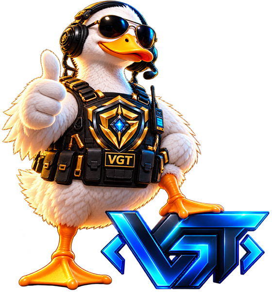
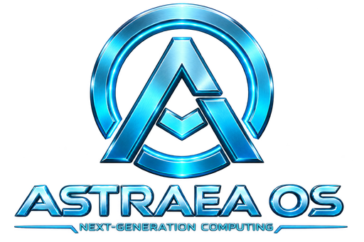
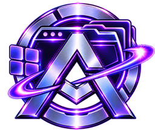
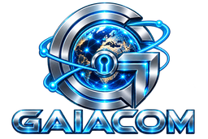
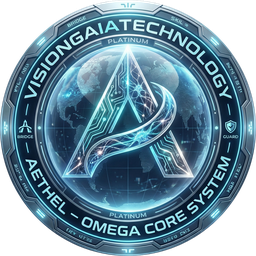

🌍 **ENTASTICLANGUAGE** &nbsp;·&nbsp; scegli il tuo qua: 
[🇬🇧 English](README.md) · [🇩🇪 Deutsch](README.de.md) · [🇷🇺 Русский](README.ru.md) · [🇨🇳 中文](README.zh.md) · [🇯🇵 日本語](README.ja.md) · [🇪🇸 Español](README.es.md) · **[🇮🇹 Italiano](README.it.md)**

---

> [!WARNING]
> **VGT È IN SVILUPPO ATTIVO.** GeDefense, AstraeaOS WordPress Edition, Astraea Workspace, GaiaCom e VGT Aethel sono attualmente in fase **alpha / beta / release candidate**. Non sono ancora pensati per l'uso in produzione senza supervisione. Valida ogni build in staging, mantieni backup testati e leggi l'avviso beta specifico del repository prima del deployment.
>
> *La nostra fiducia è alta. I nostri numeri di versione sono onesti.*

<h1>VISIONGAIATECHNOLOGY</h1>

<strong>ABBIAMO GUARDATO L'INDUSTRIA TECNOLOGICA E L'ABBIAMO RESA UN NOSTRO PROBLEMA.</strong>

Sistemi operativi. Tessuti di sicurezza. Software di produttività. 
Stiamo costruendo il mondo post-cloud perché evidentemente avere hobby non bastava.

<strong>È assurdo? Assolutamente.</strong> 
<strong>Potremmo usare soluzioni esistenti? Probabilmente.</strong> 
<strong>Lo costruiremo comunque da soli? Qua.</strong>

Benvenuto in VisionGaiaTechnology.

<em>Prendiamo sul serio il nostro codice. Le nostre scelte di vita sono sotto indagine.</em> 🦆

---

## 🦆 Sir Quacksec

> **Ogni organizzazione di ingegneria seria ha una paperella di gomma. La nostra ha un titolo, un gilet tattico e potere di veto.**

<table>
  <tr><td width="180"><strong>Nome</strong></td><td><strong>Sir Quacksec</strong></td></tr>
  <tr><td><strong>Titolo</strong></td><td>Chief Quack Officer · Head of Rubber-Duck Debugging</td></tr>
  <tr><td><strong>Divisione</strong></td><td>Dipartimento di Garanzia del Qua (DQA)</td></tr>
  <tr><td><strong>Livello di autorizzazione</strong></td><td>Livello Stagno 5 — tutte le repo, tutti gli incidenti, pane illimitato</td></tr>
  <tr><td><strong>Competenza principale</strong></td><td>Fissare gli stack trace finché non confessano</td></tr>
  <tr><td><strong>Mossa distintiva</strong></td><td>Il pollice in su che significa «ship it» o «assolutamente non shippare», a seconda dell'incidente</td></tr>
  <tr><td><strong>Nominato da</strong></td><td>Un comitato di una paperella. All'unanimità.</td></tr>
  <tr><td><strong>Noto per</strong></td><td>Approvare un'architettura con un solo «qua» e poi riscrivere silenziosamente il piano di test</td></tr>
</table>

Sir Quacksec è la nostra mascotte, il nostro debugger-paperella e l'unico membro del team che non ha mai fatto push su `main` di venerdì. Lo consideriamo un segnale di governance.

> *«Se non riesci a spiegarlo a una paperella, non l'hai capito. Se riesci a spiegarlo a Sir Quacksec, probabilmente lo stai sovraingegnerizzando.»*

---

## 👋 Chi siamo

**VisionGaiaTechnology è un laboratorio tecnologico indipendente e bootstrapped fondato da Rene Körner.** Ha 28 anni, vive a Colonia, in Germania, e attualmente costruisce lo stack come unico sviluppatore — con Sir Quacksec che offre consulenza senior e supporto emotivo.

La convinzione: gli strati software più importanti non dovrebbero essere affittati da qualcun altro. La visione è più grande di un singolo prodotto — **sovranità digitale che funziona in tutto il mondo**, costruita dall'Europa e progettata per essere usata ovunque.

Costruiamo sistemi local-first con comportamento verificato, architettura trasparente e nessuna dipendenza superflua dal cloud — dalla difesa di rete vicina al kernel ai documenti e alle note che le persone usano ogni giorno.

Nessun grande team. Nessun grande budget. Nessuna roadmap teatrale. Solo codice funzionante, repository pubblici e lo strato successivo dello stack.

**Non siamo un'Enterprise. Siamo un'Entenprise.** La differenza sta soprattutto nelle piume, ma le piume si stanno rivelando un modello di governance sorprendentemente valido.

---

## 🏛️ La differenza Entenprise

| Enterprise | Entenprise |
|:---|:---|
| Cloud-first | Local-first |
| Workshop di sinergia | Debug con la paperella di gomma |
| Sei livelli di approvazione | Una paperella, un veto |
| «Ci facciamo sentire» | «È su `main`» |
| Laboratorio di innovazione | Un laptop, testardaggine e un runner CI |
| Teatro della roadmap | Repository pubblici e changelog |
| Headcount | Breadcount |

*Sappiamo di sembrare una startup investita da una paperella. Preferiamo «laboratorio di ricerca con pipeline di deployment».*

---

## 🎯 La visione

> ### Costruire l'Apple d'Europa.
> Uno stack tecnologico completo e sovrano — dal silicio al software, dal bootloader al workspace.

**Cinque anni. Un sistema integrato.**

- **AstraeaOS** — il nostro sistema operativo.
- **GeDefense** — il tessuto di sicurezza alla base.
- **Astraea Workspace** — software di produttività per l'era post-cloud.
- **GaiaCom** — comunicazione federata e sicura post-quantum per lo stesso stack.
- **Hardware VGT** — componenti verificati con cura, controlli diretti di integrità del sistema e bootloader proprietari.

<strong>HARDWARE</strong> &nbsp;→&nbsp; <strong>BOOTLOADER</strong> &nbsp;→&nbsp; <strong>ASTRAEAOS</strong> &nbsp;→&nbsp; <strong>GEDEFENSE</strong> &nbsp;→&nbsp; <strong>ASTRAEA WORKSPACE</strong> &nbsp;→&nbsp; <strong>GAIACOM</strong>

Alcuni dicono che questo sogno sia troppo grande. Noi diciamo: molti mattoni esistono già. Manca il capitale — e le persone che credono che sistemi sovrani e infrastruttura hardware verificata valgano la pena di essere costruiti.

*Sì, sappiamo come suona. Lo costruiamo comunque.*

Se costruisci, investi, fai ricerca o operi in questo spazio: **dovremmo parlare.**

---

## 📦 I progetti

*La parte seria. Questo esiste davvero — incluse le parti ancora in alpha.*

<table>
  <tr>
    <td width="104" align="center" valign="middle">
      
    </td>
    <td>
      <strong>AstraeaOS</strong> &nbsp;<strong>SVILUPPO PRIVATO</strong> 
      Un sistema operativo di nuova generazione con boot verificato, integrità diretta del sistema e un'esperienza nativa coerente — progettato come fondamento dello stack. 
      Repository privato · nessun codice pubblico ancora
    </td>
  </tr>
  <tr>
    <td width="104" align="center" valign="middle">
      
    </td>
    <td>
      <strong>AstraeaOS ™ WordPress Edition</strong> &nbsp;<strong>ALPHA</strong> 
      WordPress senza lo stack di plugin: una distribuzione security-first con crittografia, recovery, privacy, mail, performance e infrastruttura proprietari integrati direttamente nella piattaforma. 
      
    </td>
  </tr>
  <tr>
    <td width="104" align="center" valign="middle">
      
    </td>
    <td>
      <strong>GeDefense</strong> &nbsp;<strong>BETA PUBBLICA</strong> 
      Difesa di rete vicina al kernel, XDR host e evidenza cifrata. Un unico tessuto di sicurezza su Linux, WordPress, Android e Windows. 
      
      
      
      
      
    </td>
  </tr>
  <tr>
    <td width="104" align="center" valign="middle">
      
    </td>
    <td>
      <strong>Astraea Workspace</strong> &nbsp;<strong>SVILUPPO ATTIVO</strong> 
      Una suite di produttività local-first per il lavoro concentrato: documenti, note, attività, ricerca e un workspace coerente che non dipende da un cloud affittato. 
      
    </td>
  </tr>
  <tr>
    <td width="104" align="center" valign="middle">
      
    </td>
    <td>
      <strong>GaiaCom</strong> &nbsp;<strong>BETA TECNICA</strong> 
      Comunicazione federata con crittografia end-to-end nativa e crittografia ibrida post-quantum — conversazioni, chat di gruppo e scambio file senza fiducia nel server. 
      
    </td>
  </tr>
  <tr>
    <td width="104" align="center" valign="middle">
      
    </td>
    <td>
      <strong>VGT Aethel</strong> &nbsp;<strong>BETA ATTIVA</strong> 
      Un OS sovrano di intelligence strategica: AI local-first, un IDE VGT Coder agentico e un desktop operativo personale, costruito per tenere l'intelligenza sulla macchina. 
      
    </td>
  </tr>
</table>

---

## ⚙️ Su cosa ottimizziamo

- **Local-first per impostazione predefinita.** Nessun control plane cloud. Nessuna fiducia affittata.
- **Evidenza invece di affermazioni.** Test, manifest e audit trail fanno parte del prodotto.
- **Hardening reversibile.** La sicurezza deve essere osservabile, regolabile e ripristinabile.
- **Possedere l'intero stack.** Sistema operativo, sicurezza, produttività e, col tempo, hardware.
- **Serietà dove conta.** Le paperelle servono al debug. La produzione serve all'evidenza.

---

## ❓ Domande frequentemente quacquate

| Domanda | Risposta |
|:---|:---|
| Siete una startup? | Sì. E un laboratorio di ricerca. Una startup con un problema di ricerca, un laboratorio di ricerca con una pipeline di rilascio e una paperella con potere di veto. |
| Perché la mascotte? | Ogni team di ingegneria ha una paperella di gomma. Alla nostra abbiamo dato una qualifica e un gilet tattico. |
| L'umorismo è un campanello d'allarme? | L'umorismo è portante. Il codice non è uno scherzo. |
| Posso usare i prodotti in produzione? | Non senza supervisione. Vedi l'avviso in alto. Staging e backup non sono opzionali. |
| Perché costruite tutto da soli? | Perché affittare le proprie fondamenta è strano. |
| Assumete? | Le assunzioni le gestisce la paperella. Al momento la risposta è «qua». |
| Come posso aiutare? | Contribuisci, testa, segnala issue — o sostieni il lavoro qui sotto. Qua graditi. |

---

## 🔗 Connettiti

- Website: **[visiongaiatechnology.de](https://visiongaiatechnology.de)**
- GitHub: **[github.com/visiongaiatechnology](https://github.com/visiongaiatechnology)**
- Licenza: **[AGPL-3.0-or-later](https://www.gnu.org/licenses/agpl-3.0)** per i progetti open source.
- Sicurezza: usa la security policy o gli advisory privati del repository corrispondente.

---

## 💛 Sostieni

Lo sviluppo indipendente è finanziato da persone che vogliono che questo stack esista. Se vuoi sostenere il lavoro:

| Modalità | Indirizzo |
|:---|:---|
| **PayPal** | [paypal.me/dergoldenelotus](https://paypal.me/dergoldenelotus) |
| **Bitcoin** | `bc1q3ue5gq822tddmkdrek79adlkm36fatat3lz0dm` |
| **ETH / USDT (ERC-20)** | `0xD37DEfb09e07bD775EaaE9ccDaFE3a5b2348Fe85` |

Solo supporto volontario — non implica equity, SLA o licenza di produzione. I trasferimenti crypto sono irreversibili; verifica rete e indirizzo prima di inviare.

 
<strong>COSTRUITO IN EUROPA. PROGETTATO PER LA SOVRANITÀ. SUPERVISIONATO DA UNA PAPERELLA.</strong> 
🦆 Qua.

