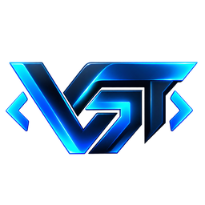

> [!WARNING]
> **VGT IS IN ACTIVE DEVELOPMENT.** GeDefense, Astraea Workspace and VGT Aethel are currently **public beta / release candidate** software. They are not yet intended for unsupervised production use. Validate every build in staging, keep tested backups and read the repository-specific beta notice before deployment.

<h1>VISIONGAIA TECHNOLOGY</h1>

<strong>SOVEREIGN TECHNOLOGY. BUILT FROM THE BOOTLOADER UP.</strong>

An independent European technology lab building the operating system, 
security fabric and productivity layer for a post-cloud world.

---

## Who we are

**VisionGaiaTechnology is an independent, bootstrapped technology lab founded by Rene Körner.** He is 28, based in Cologne, Germany, and currently builds the stack as its sole developer.

The conviction: the most important software layers should not be rented from someone else. The vision is larger than a single product — **digital sovereignty that works worldwide**, built from Europe and designed to be used anywhere.

We build local-first systems with verified behavior, transparent architecture and no unnecessary cloud dependency — from kernel-near network defense to the documents and notes people use every day.

No big team. No big budget. No theatrical roadmap. Just working code, public repositories and the next layer of the stack.

---

## The vision

> ### Build the Apple of Europe.
> A complete, sovereign technology stack — from silicon to software, from bootloader to workspace.

**Five years. Four layers. One integrated system.**

- **AstraeaOS** — our own operating system.
- **GeDefense** — the security fabric beneath it.
- **Astraea Workspace** — productivity software for the post-cloud era.
- **VGT hardware** — carefully verified components, direct system-integrity checks and our own bootloaders.

<strong>HARDWARE</strong> &nbsp;→&nbsp; <strong>BOOTLOADER</strong> &nbsp;→&nbsp; <strong>ASTRAEAOS</strong> &nbsp;→&nbsp; <strong>GEDEFENSE</strong> &nbsp;→&nbsp; <strong>ASTRAEA WORKSPACE</strong>

Some say this dream is too big. We say: many of the building blocks already exist. What is still missing is capital — and the people who believe that sovereign systems and verified hardware infrastructure are worth building.

If you build, invest, research or operate in this space: **we should talk.**

---

## The projects

<table>
  <tr>
    <td width="104" align="center" valign="middle">
      
    </td>
    <td>
      <strong>GeDefense</strong> &nbsp;<strong>PUBLIC BETA</strong> 
      Kernel-near network defense, host XDR and encrypted evidence. One security fabric across Linux, WordPress, Android and Windows. 
      
      
      
      
    </td>
  </tr>
  <tr>
    <td width="104" align="center" valign="middle">
      
    </td>
    <td>
      <strong>Astraea Workspace</strong> &nbsp;<strong>ACTIVE DEVELOPMENT</strong> 
      A local-first productivity suite for focused work: documents, notes, tasks, research and a coherent workspace that does not depend on a rented cloud. 
      
    </td>
  </tr>
  <tr>
    <td width="104" align="center" valign="middle">
      
    </td>
    <td>
      <strong>AstraeaOS</strong> &nbsp;<strong>PRIVATE DEVELOPMENT</strong> 
      A next-generation operating system with verified boot, direct system integrity and a coherent native experience — designed as the foundation of the stack. 
      Private repository · no public source yet
    </td>
  </tr>
</table>

### Applied AI

**VGT Aethel** — AI research and agentic tooling with a sovereignty-first stance: local-first guardrails, auditable tool use and no blind trust in model output.

---

## What we optimize for

- **Local-first by default.** No cloud control plane. No rented trust.
- **Evidence over claims.** Tests, manifests and audit trails are part of the product.
- **Reversible hardening.** Security should be observable, adjustable and recoverable.
- **Own the whole stack.** Operating system, security, productivity and eventually hardware.

---

## Connect

- Website: **[visiongaiatechnology.de](https://visiongaiatechnology.de)**
- GitHub: **[github.com/visiongaiatechnology](https://github.com/visiongaiatechnology)**
- License: **[AGPL-3.0-or-later](https://www.gnu.org/licenses/agpl-3.0)** for the open-source projects.
- Security: use the security policy or private security advisory in the respective repository.

---

## Support

Independent development is funded by people who want this stack to exist. If you want to support the work:

| Method | Address |
|:---|:---|
| **PayPal** | [paypal.me/dergoldenelotus](https://paypal.me/dergoldenelotus) |
| **Bitcoin** | `bc1q3ue5gq822tddmkdrek79adlkm36fatat3lz0dm` |
| **ETH / USDT (ERC-20)** | `0xD37DEfb09e07bD775EaaE9ccDaFE3a5b2348Fe85` |

Voluntary support only — no equity, SLA or production license is implied. Crypto transfers are irreversible; verify the network and address before sending.

 
<strong>BUILT IN EUROPE. DESIGNED FOR SOVEREIGNTY.</strong>

